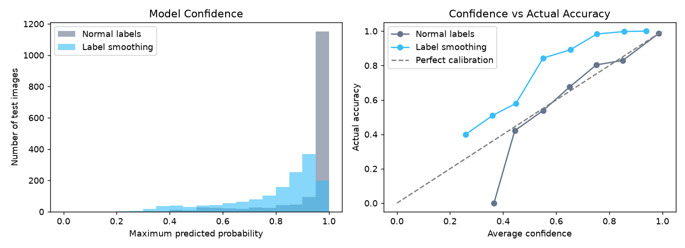

# Transformer Internals Lab

Two small NumPy projects that explain two ideas from the Transformer lecture:
**Multi-Head Attention (MHA)** and **Label Smoothing**.

## What is inside

| File | What it does |
|------|--------------|
| `mha.py` | Multi-Head Attention built from scratch with NumPy |
| `label_smoothing.py` | Experiment comparing normal labels vs label smoothing |
| `label_smoothing_results.png` | Graph produced by the experiment |

## Setup

```
pip install numpy matplotlib scikit-learn
python mha.py
python label_smoothing.py
```

## 1. Multi-Head Attention from scratch (`mha.py`)

Steps implemented:
1. Project the input into Q, K, V
2. Split them into heads (one part per head)
3. Scaled dot-product attention in every head, in parallel
4. Concatenate the outputs of all heads
5. Pass the result through a final linear layer

The script checks itself:
- output shape equals input shape
- every row of attention weights sums to 1
- the vectorised version equals a slow loop over heads
- a causal mask gives zero weight to future tokens

## 2. Label Smoothing experiment (`label_smoothing.py`)

Formula: `smooth label = (1 - eps) * one_hot + eps / K`

The same small neural network is trained twice on 300 images of the
scikit-learn digits dataset (K = 10 classes): once with normal labels and
once with eps = 0.1. Results are the mean over 10 random seeds.

| Setting         | Accuracy | Avg confidence | ECE   | Test NLL |
|-----------------|----------|----------------|-------|----------|
| Normal labels   | 0.943    | 0.936          | 0.014 | 0.200    |
| Smoothing (0.1) | 0.948    | 0.798          | 0.151 | 0.310    |



### What I learned

- Label smoothing gave slightly higher accuracy and reduced overconfidence.
- But on this small, easy dataset it overshot: the smoothed model became
  underconfident, so ECE and NLL got worse.
- So label smoothing is not a free win. The value of eps needs tuning.

### Limitations

Small dataset, one simple network, no hyper-parameter tuning. These numbers
should not be generalised to large Transformers.

## Future work

- Sweep eps (0, 0.02, 0.05, 0.1, 0.2) and plot accuracy and ECE
- Plug `MultiHeadAttention` into a small text classifier
- Add attention heatmaps per head